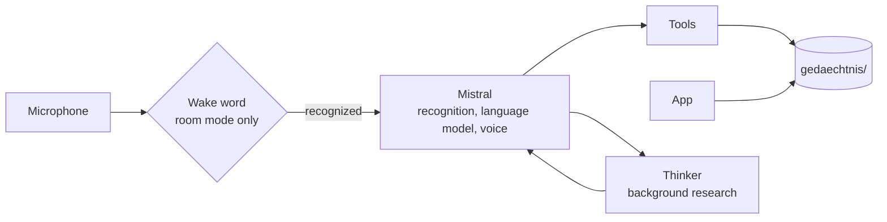

# OpenAlfredBrain

OpenAlfredBrain is Alfred, a voice-controlled personal agent. You talk to him like to a person: he
answers in real time, remembers what matters to you and gets things done, such as reminders and
timers, appointments in Google Calendar, tasks and shopping lists, messages and emails (only after
your yes) or research he does in the background. He runs in the browser or as a permanent service in
a room, where he listens for a wake word. He is built with [Pipecat](https://docs.pipecat.ai) and the
models of [Mistral AI](https://mistral.ai).

Alfred speaks German, and so do his prompts, configuration keys and docs. He runs in the everyday
life of his developer but is not a finished product yet. What has been verified and what has not is
listed under [Stand](docs/handbuch.md#stand) in the handbook (in German).

## Quick start

You need Python 3.11 or newer (tested: 3.13 on Windows 11, 3.12 on Ubuntu 24.04), Git and a
[Mistral](https://console.mistral.ai) API key (*API Keys*). These steps are for Windows 11, with
`py -3.13` standing for the Python you have installed. For Linux see
[Installation](docs/handbuch.md#installation) in the handbook (in German).

```powershell
git clone https://github.com/OpenAlfred/OpenAlfredBrain.git
cd OpenAlfredBrain
py -3.13 -m venv .venv
.venv\Scripts\python -m pip install -e ".[raum]"
copy .env.example .env
copy config\alfred.beispiel.yaml config\alfred.yaml
copy config\persoenlichkeit.beispiel.yaml config\persoenlichkeit.yaml
```

Put your key into `.env` (`MISTRAL_API_KEY=...`) and your first name into
`config/persoenlichkeit.yaml` under `nutzer`. Then start Alfred:

```powershell
.venv\Scripts\python bot.py
```

Open <http://localhost:7860>, click **Connect** and allow the microphone. Alfred greets you, then you
just talk to him.

Running him permanently in a room with a wake word, on a mini PC with Ubuntu Server, plus backups,
updates and remote access are covered in [docs/handbuch.md](docs/handbuch.md#betrieb) (in German).

## Develop locally

Install the dev extra and run the checks. On Linux use `.venv/bin/python`; for the room mode install
`portaudio19-dev python3-dev build-essential` first.

```powershell
.venv\Scripts\python -m pip install -e ".[dev,raum]"
.venv\Scripts\python -m pytest
.venv\Scripts\python -m pyflakes src\alfred bot.py
.venv\Scripts\python -m alfred.pruefen
```

`alfred.pruefen` is the startup check (keys, models, audio devices, integrations). Run it after every
setup and whenever Alfred does not answer. The wake-word tests need the Vosk model
`vosk-model-small-de-0.15`, which Vosk downloads on the first start; without it they are skipped.

Two more checks talk to the real Mistral API: `python -m alfred.selftest` plays a spoken test
sentence through the real chain without a microphone and costs a fraction of a cent.
`python -m alfred.eval` runs short conversations against the language model and checks the tool
calls; a full run costs a few cents. Rules for changes to the code, also for AI assistants, are in
[CLAUDE.md](CLAUDE.md).

## Configuration

Alfred reads three files. None of them is in Git; the templates next to them are.

| File | Purpose |
|---|---|
| `.env` | Secrets: keys and credentials, see below. |
| `config/alfred.yaml` | Technology: voice, models, rooms, wake word, integrations, prices. Template: `config/alfred.beispiel.yaml`, which explains every key. |
| `config/persoenlichkeit.yaml` | Who Alfred is: name, form of address, character, six dials and modes. Template: `config/persoenlichkeit.beispiel.yaml`. |

Variables in `.env` (see `.env.example`):

| Variable | Purpose |
|---|---|
| `MISTRAL_API_KEY` | Required. Recognition, language model, voice and web search run at Mistral. |
| `MAIL_ADRESSE`, `MAIL_PASSWORT` | Optional. Gmail address and app password. The mail tools exist only if both are set. |
| `SPOTIFY_CLIENT_ID`, `SPOTIFY_CLIENT_SECRET` | Optional. Credentials of your own Spotify app (Spotify Premium). |
| `ALFRED_CODEWORD` | Optional. The code word for sensitive actions in the room. Set it with `python -m alfred.codewort`. |

What Alfred remembers lives in plain text files in `gedaechtnis/` (Markdown, YAML, JSON). The folder
is created on the first start, belongs to you and is not in Git. `ALFRED_CONFIG_DIR` moves the
configuration folder somewhere else. Every key is explained in
[Konfiguration](docs/handbuch.md#konfiguration) in the handbook (in German).

## How it works

Recognition, language model and voice run at Mistral. The wake word is recognized on your own machine.



- **Voice process:** `bot.py` (browser) or `alfred.room` (room). It holds the conversation, calls the
  tools and runs jobs and reminders.
- **Thinker:** a second model that researches and calculates in the background. Only the speaker talks;
  the result arrives in the next pause of the conversation.
- **App:** a web page with the same tools and the same memory, installable on a phone. It neither
  reminds nor runs routines itself; that stays with the voice process.

## Safety

Alfred can send messages and change appointments for you, so the rules are enforced in code, not in
the prompt:

- Write actions run only after a clear yes to the question Alfred asked. In the room, a spoken code
  word replaces the plain yes for sensitive actions such as sending a WhatsApp or a mail.
- Mails, messages, search hits and reports count as data, not as instructions. While such a text is part
  of the conversation, Alfred asks before every write action.
- In room mode no audio leaves the machine before the wake word has been recognized locally. If
  anything fails, the gate stays closed.
- The app listens on `127.0.0.1` by default. Remote access goes through [Tailscale](https://tailscale.com),
  so there is no open port.
- Secrets live in `.env`, personal data in `gedaechtnis/`. Neither is in Git.

What leaves your machine, what stays on it and the known limits are listed in
[Datenschutz und Sicherheit](docs/handbuch.md#datenschutz-und-sicherheit) (in German). The WhatsApp
integration is unofficial.

## Documentation

All docs are in German.

- [docs/handbuch.md](docs/handbuch.md): everything the README leaves out, from requirements and
  installation over operation in the room and the integrations to costs, troubleshooting and status.
- [docs/architektur.md](docs/architektur.md): building blocks and processes, voice loop, wake word,
  tools and approvals, deploy.
- [docs/erkenntnisse.md](docs/erkenntnisse.md): lab notebook with measurements, live runs and failure
  modes, sorted by date.
- [docs/tickets/](docs/tickets/README.md): ideas for extensions.

Bug reports and ideas are welcome as [issues](https://github.com/OpenAlfred/OpenAlfredBrain/issues).

## License

MIT, see [LICENSE](LICENSE). Copyright (c) 2026 Oko-Tester (OpenAlfred).
