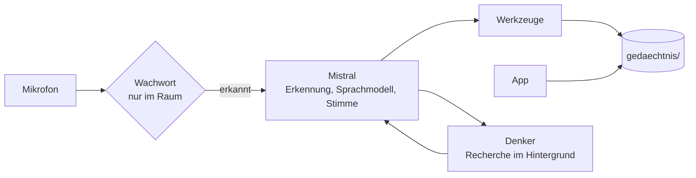

# Alfred: Handbuch

Ausführliche Anleitung zu Einrichtung, Betrieb und Anbindungen. Die Kurzfassung steht in der
[README](../README.md).

Alfred ist ein sprachgesteuerter persönlicher Agent. Du sprichst mit ihm wie mit einem Menschen:
Er antwortet in Echtzeit, merkt sich, was dir wichtig ist, und erledigt Dinge für dich, etwa
Erinnerungen und Timer, Termine im Google Kalender, Aufgaben und Einkaufslisten, Nachrichten und
E-Mails (erst nach deinem Ja) oder Recherchen, die er im Hintergrund erledigt.

Alfred läuft im Browser oder dauerhaft im Raum, wo er auf sein Wachwort hört. Grundlage sind
[Pipecat](https://docs.pipecat.ai) und die Modelle von [Mistral AI](https://mistral.ai).

> **Entwicklungsstand (10.10.2026).** Alfred läuft im Alltag seines Entwicklers, ist aber noch kein
> fertiges Produkt. Was geprüft ist und was nicht, steht unter [Stand](#stand).

## Inhalt

- [Funktionen](#funktionen)
- [Schnellstart](#schnellstart)
- [Funktionsweise](#funktionsweise)
- [Voraussetzungen](#voraussetzungen)
- [Installation](#installation)
- [Konfiguration](#konfiguration)
- [Betrieb](#betrieb)
- [Was Alfred kann](#was-alfred-kann)
- [Anbindungen einrichten](#anbindungen-einrichten)
- [Datenschutz und Sicherheit](#datenschutz-und-sicherheit)
- [Kosten](#kosten)
- [Prüfen und testen](#prüfen-und-testen)
- [Fehlersuche](#fehlersuche)
- [Projektaufbau](#projektaufbau)
- [Weiterführende Dokumentation](#weiterführende-dokumentation)
- [Entwickeln und Mitwirken](#entwickeln-und-mitwirken)
- [Stand](#stand)
- [Lizenz](#lizenz)

## Funktionen

- **Gespräch in Echtzeit.** Alfred erkennt Pausen und antwortet, ohne dass du tippen musst. Er hält
  inne, wenn du ihn unterbrichst, und lässt dich ausreden, wenn du „Hör mal zu" sagst.
- **Zwei Betriebsarten.** Im Browser für den Schreibtisch oder im Raum als Dauerdienst mit Mikrofon,
  Lautsprecher und einem Wachwort, das lokal erkannt wird.
- **Werkzeuge.** Erinnerungen, Timer, Kalender, Aufgaben, Einkaufsliste, Vorräte, Wochenpläne,
  Ernährung, Ausgaben, Musik, WhatsApp, E-Mail, Wetter, Websuche und Aufträge im Hintergrund.
- **Gedächtnis aus Textdateien.** Was Alfred sich merkt, steht in Markdown und YAML. Du kannst es
  öffnen und von Hand ändern.
- **Nichts Wichtiges ohne dein Ja.** Nachrichten, Mails und Termine verschickt oder ändert Alfred erst
  nach einem gesprochenen Ja. Was er nicht sicher zuordnen kann, fragt er nach.
- **Persönlichkeit und Modi.** Name, Anrede, Tonfall und Modi wie „Fokus" oder „Feierabend", die den
  Tonfall und die verfügbaren Werkzeuge umschalten.
- **App für Browser und Handy.** Eine Zentrale mit Alfreds Zustand, dazu Fähigkeiten, Heute, Aufgaben,
  Aufträge, Einkauf, Ernährung, Haushalt und Schreiben mit Alfred (jeder Werkzeugaufruf als Karte), auch
  per Sprachnachricht. Dunkel oder hell, auf dem Handy als Web-App installierbar.
- **Kosten im Blick.** Alfred zählt Verbrauch und Kosten pro Tag und nennt sie auf Nachfrage.

## Schnellstart

Mit Python und einem Mistral-Schlüssel kommst du in etwa zehn Minuten zu einem ersten Gespräch im
Browser. Die Anleitung gilt für Windows; für Linux siehe [Installation](#installation).

1. Lege unter <https://console.mistral.ai> → *API Keys* einen Schlüssel an.
2. Installiere Python 3.13 (siehe [Voraussetzungen](#voraussetzungen)) und richte das Projekt in
   PowerShell ein:

   ```powershell
   git clone https://github.com/OpenAlfred/alfred.git
   cd alfred
   py -3.13 -m venv .venv
   .venv\Scripts\python -m pip install -e ".[raum]"
   copy .env.example .env
   copy config\alfred.beispiel.yaml config\alfred.yaml
   copy config\persoenlichkeit.beispiel.yaml config\persoenlichkeit.yaml
   ```

3. Trage in `.env` deinen Schlüssel ein: `MISTRAL_API_KEY=dein-schlüssel`.
4. Optional: Trage in `config/persoenlichkeit.yaml` bei `nutzer` deinen Vornamen ein. Die Stimme ist in
   `config/alfred.yaml` schon auf `gb_oliver_neutral` gesetzt, eine englische Standardstimme, die Deutsch
   mit Akzent spricht. Eine andere Stimme wählst du unter `stimme`; `.venv\Scripts\python -m alfred.voices`
   listet die Stimmen deines Kontos auf.
5. Starte Alfred:

   ```powershell
   .venv\Scripts\python bot.py
   ```

   Öffne <http://localhost:7860>, klicke auf **Connect** und erlaube das Mikrofon. Alfred begrüßt
   dich, danach sprichst du einfach mit ihm.

Wie er heißt und wie er dich anspricht, stellst du in `config/persoenlichkeit.yaml` ein, seine
Stimme in `config/alfred.yaml` (siehe [Konfiguration](#konfiguration)).

## Funktionsweise

Alfred besteht aus drei Teilen: dem Sprach-Prozess, der Gespräche führt, der App und den Dateien im
Gedächtnisordner, auf die beide zugreifen. Erkennung, Sprachmodell und Stimme laufen bei Mistral; das
Wachwort erkennt dein Rechner selbst.



- **Sprach-Prozess:** `bot.py` (Browser) oder `alfred.room` (Raum). Er führt das Gespräch, ruft die
  Werkzeuge auf und führt Aufträge und Erinnerungen aus.
- **Denker:** Ein zweites Modell, das im Hintergrund recherchiert und rechnet. Nur der Sprecher
  spricht; das Ergebnis kommt in der nächsten Gesprächspause.
- **App:** Eine Webseite mit denselben Werkzeugen und demselben Gedächtnis. Sie erinnert nicht
  selbst und startet keine Routinen; das bleibt beim Sprach-Prozess.

## Voraussetzungen

### Software

| Komponente | Anforderung | Hinweis |
|---|---|---|
| Python | 3.11 oder neuer, empfohlen 3.13 | Getestet: 3.13 unter Windows 11, 3.12 unter Ubuntu 24.04. Neuere Versionen sind nicht geprüft. |
| Git | aktuell | Zum Herunterladen und für Updates. Ohne Git: ZIP-Datei von GitHub laden. |
| Betriebssystem | Windows 11 oder Linux (Ubuntu 24.04 Server getestet) | macOS ist nicht getestet. |
| Docker | optional | Nur für die eigene Suchmaschine SearXNG. |

Prüfe unter Windows mit `py -0`, ob Python 3.13 installiert ist.

### Konten und Schlüssel

| Dienst | Pflicht | Wofür |
|---|---|---|
| Mistral-Konto mit API-Schlüssel | ja | Erkennung, Sprachmodell, Stimme, Websuche, Auslesen von Fotos |
| Google-Konto | nein | Google Kalender und E-Mail (Gmail) |
| Spotify Premium mit eigener Developer-App | nein | Musik per Stimme steuern |
| WhatsApp auf dem Handy | nein | Nachrichten senden und vorlesen lassen |
| ntfy | nein | Push-Nachrichten aufs iPhone |
| Tailscale | nein | Zugriff vom Handy von unterwegs, ohne offenen Port |

### Hardware

- **Browser-Modus:** jeder Rechner mit Mikrofon, Lautsprecher und einem aktuellen Browser. Lokal
  rechnet Alfred wenig: Das Wachwort-Modell (rund 45 MB) und das Stimmmodell (26 MB) laufen auf dem
  Rechner, die Sprachmodelle bei Mistral.
- **Raum-Modus:** ein Mikrofon mit 16 kHz, mono (jedes USB-Gerät), ein Lautsprecher und
  Echo-Unterdrückung. Ohne Echo-Unterdrückung hört Alfred sich selbst, hält das für einen Einwurf und
  unterbricht sich. Konferenzlautsprecher erledigen das in Hardware. Gut geeignet sind der
  **Jabra Speak 410** (USB, ohne Akku, gebraucht rund 30 bis 36 €, Stand 3.10.2026) und der
  **Jabra Speak 510** (zusätzlich Bluetooth und eine LED, die Alfreds Zustand zeigt). Mit einer
  USB-Verlängerung von drei Metern steht das Gerät mitten im Raum.
- **Dauerbetrieb:** Ein Mini-PC ohne GPU reicht, beim Entwickler ein Intel i7-6700T mit 16 GB RAM.
  Alfred rechnet lokal wenig, die Last liegt bei Mistral.

## Installation

### Windows

1. **Python 3.13** von <https://www.python.org/downloads/> installieren. Aktiviere im Installer
   „Add python.exe to PATH" und den Python-Launcher `py`.
2. **Projekt holen** (mit Git, sonst ZIP-Datei von GitHub laden und entpacken):

   ```powershell
   git clone https://github.com/OpenAlfred/alfred.git
   cd alfred
   ```

3. **Umgebung und Pakete** (`[raum]` brauchst du für Mikrofon und Lautsprecher am Rechner):

   ```powershell
   py -3.13 -m venv .venv
   .venv\Scripts\python -m pip install -e ".[raum]"
   ```

4. **Dateien anlegen:**

   ```powershell
   copy .env.example .env
   copy config\alfred.beispiel.yaml config\alfred.yaml
   copy config\persoenlichkeit.beispiel.yaml config\persoenlichkeit.yaml
   ```

5. Trage in `.env`, `config/alfred.yaml` und `config/persoenlichkeit.yaml` deine Werte ein, siehe [Konfiguration](#konfiguration).

### Linux (Ubuntu 24.04 Server oder Desktop)

1. Systempakete installieren (PyAudio braucht PortAudio und einen Compiler):

   ```bash
   sudo apt install git python3-venv python3-dev build-essential portaudio19-dev
   ```

2. Projekt holen und einrichten:

   ```bash
   git clone https://github.com/OpenAlfred/alfred.git
   cd alfred
   python3 -m venv .venv
   .venv/bin/python -m pip install -e ".[raum]"
   cp .env.example .env
   cp config/alfred.beispiel.yaml config/alfred.yaml
   cp config/persoenlichkeit.beispiel.yaml config/persoenlichkeit.yaml
   chmod 600 .env
   ```

3. Trage in `.env`, `config/alfred.yaml` und `config/persoenlichkeit.yaml` deine Werte ein, siehe [Konfiguration](#konfiguration).

Unter Linux heißt der Python-Aufruf `.venv/bin/python` statt `.venv\Scripts\python`. Für den
Dauerbetrieb auf einem Server siehe [Dauerbetrieb unter Ubuntu Server](#dauerbetrieb-unter-ubuntu-server).

### Zusatzpakete

Die Abhängigkeiten stehen in `pyproject.toml`. Die Zusatzpakete lassen sich kombinieren, etwa
`".[raum,musik,dev]"`.

| Befehl | Enthält | Wofür |
|---|---|---|
| `pip install -e .` | Pipecat (Mistral, Silero, WebRTC), Google-Bibliotheken | Nur der Browser-Modus |
| `pip install -e ".[raum]"` | PyAudio, Vosk (Wachwort), hidapi (LED am Jabra) | Raum-Modus, Hörtest, Stimmprofil |
| `pip install -e ".[musik]"` | spotipy | Spotify |
| `pip install -e ".[dev]"` | pytest, pyflakes | Tests und statische Prüfung |

## Konfiguration

Alfred liest seine Einstellungen aus drei Dateien:

| Datei | Enthält | Im Git? |
|---|---|---|
| `.env` | Geheimnisse: Schlüssel und Zugangsdaten | nein |
| `config/alfred.yaml` | Technik: Stimme, Modelle, Räume, Wachwort, Anbindungen, Preise | nein (Vorlage: `config/alfred.beispiel.yaml`) |
| `config/persoenlichkeit.yaml` | Wer Alfred ist, wie er spricht, welche Modi es gibt | nein (Vorlage: `config/persoenlichkeit.beispiel.yaml`) |

Das Gedächtnis liegt separat im Ordner `gedaechtnis/` (siehe unten).

### `.env`

| Variable | Pflicht | Bedeutung |
|---|---|---|
| `MISTRAL_API_KEY` | ja | Schlüssel von <https://console.mistral.ai> → *API Keys* |
| `MAIL_ADRESSE`, `MAIL_PASSWORT` | nein | Gmail-Adresse und App-Passwort. Nur wenn beides gesetzt ist, gibt es die E-Mail-Werkzeuge. |
| `SPOTIFY_CLIENT_ID`, `SPOTIFY_CLIENT_SECRET` | nein | Zugangsdaten der eigenen Spotify-App, siehe [Spotify](#spotify) |

Die `.env` steht in `.gitignore`. Fehlt der Mistral-Schlüssel, bricht Alfred beim Start mit einem
Hinweis ab.

### `config/alfred.yaml`

Das ist die Datei für deinen Rechner. Die Vorlage `config/alfred.beispiel.yaml` liegt im Git und
erklärt jeden Schlüssel. Fehlt deine Datei, nimmt Alfred die Vorlage. Trage deine Werte aber in die
eigene Datei ein: Sie liegt nicht im Git, bleibt also bei Updates unberührt und gehört zur Sicherung.
Änderungen wirken beim nächsten Start.

Die wichtigsten Schlüssel:

| Schlüssel | Bedeutung | Vorgabe |
|---|---|---|
| `stimme` | Stimme der Sprachausgabe, Slug oder UUID aus `python -m alfred.voices`. Eine eigene deutsche Stimme legst du in der Mistral-Konsole an. | `gb_oliver_neutral`, eine englische Standardstimme, die Deutsch mit Akzent spricht |
| `modelle.sprecher` | Modell für das Gespräch | `mistral-small-2603` |
| `modelle.denker` | Modell für Recherche und Rechnen im Hintergrund | `zai-glm-5-3` |
| `modelle.werkzeuge` | Modell für Websuche und Code-Ausführung über Mistrals Conversations API | `mistral-small-2603` |
| `gespraech.begruessung` | Alfred begrüßt dich im Browser-Modus | `true` |
| `gespraech.sprachen` | Erkannte Sprachen; Transkripte in anderen Sprachen verwirft Alfred | `[de, en]` |
| `gespraech.zuhoeren_pause_sekunden` | Stille, bevor Alfred im Zuhör-Modus antwortet | `5` |
| `wachwort.phrasen` | Aufwecksatz im Raum-Modus | `[alfred]` |
| `wachwort.bereitschaft` | Start im Standby, siehe [Raum mit Wachwort](#raum-mit-wachwort) | `false` |
| `wachwort.modell` | Vosk-Modell für das Wachwort. `vosk-model-de-0.21` (1,9 GB) erkennt es aus größerer Entfernung besser. | `vosk-model-small-de-0.15` |
| `raeume` | Räume mit Namensteilen für Mikrofon und Lautsprecher | `buero` mit `Jabra` |
| `proaktiv` | Ruhezeit, Tageslimit und Modi für ungefragte Ansagen | Ruhe 22:00 bis 07:00, höchstens 6 am Tag |
| `jabra.led_aktiv` | LED am Jabra Speak 510 steuern | `true` |
| `wetter.ort` | Ersatzort für die Wettervorhersage, falls das Profil leer ist | leer |
| `suche.url` | Adresse einer eigenen SearXNG-Instanz. Leer heißt: Mistrals Websuche. | leer |
| `benachrichtigung.*` | Push-Server (`url`), Thema, Zugangstoken und App-Adresse | leer, also aus |
| `whatsapp.landesvorwahl` | Vorwahl für Nummern, die mit 0 beginnen | `49` |
| `stimmerkennung.*` | Stimmerkennung an oder aus (`aktiv`), Stimmprofil, Sprechermodell und Schwellen | aus |
| `preise.*` | Preise für die Kostenanzeige | Listenpreise, siehe [Kosten](#kosten) |

Zeitangaben wie `ruhe_von` schreibst du in Anführungszeichen (`"22:00"`), sonst liest YAML sie als
Zahl.

Mit der Umgebungsvariable `ALFRED_CONFIG_DIR` legst du den Konfigurationsordner an einen anderen Ort,
etwa außerhalb des Git-Projekts. Alfred leitet dann auch die übrigen Pfade vom übergeordneten Ordner
ab, Gedächtnis und Logs eingeschlossen.

### `config/persoenlichkeit.yaml`

Hier steht, wer Alfred ist. Die Datei gehört dir und liegt nicht im Git. Vorlage ist
`config/persoenlichkeit.beispiel.yaml`. Fehlt deine Datei, nimmt Alfred die Vorlage, und `pruefen`
weist darauf hin. Kopiere die Vorlage nach `config/persoenlichkeit.yaml` und passe sie an.

- `name`: Wie Alfred heißt.
- `nutzer`: Wie er dich anspricht. Trage deinen Vornamen ein.
- `anrede`: `du` oder `sie`.
- `charakter`: Freitext, wer Alfred ist und wie er auftritt. Die Vorlage vermeidet bewusst das Wort
  „Butler", weil das Sprachmodell die Rolle sonst wörtlich spielt und Kaffee anbietet.
- `regler`: Sechs Regler von 0 bis 10: `widerspruch`, `humor`, `foermlichkeit`,
  `ausfuehrlichkeit`, `proaktivitaet`, `waerme`. Welcher Satz zu welcher Stufe gehört, steht in
  `src/alfred/persona.py`.
- `regeln`: Sätze, die in jedem Modus gelten.
- `aktiver_modus` und `modi`: Benannte Voreinstellungen, die Regler überschreiben und Werkzeuggruppen
  abschalten (siehe [Modi und Werkzeuggruppen](#modi-und-werkzeuggruppen)).

### Das Gedächtnis (`gedaechtnis/`)

Der Ordner entsteht beim ersten Start. Alles darin sind Textdateien (Markdown, YAML, JSON, Log), und alles gehört dir:

| Datei | Inhalt | Wer schreibt |
|---|---|---|
| `kontext.md` | Was Alfred immer wissen soll. Steht vollständig im Systemprompt. | du |
| `wissen/<bereich>.md` | Was Alfred mit „Merk dir …" ablegt | Alfred |
| `protokoll/<tag>.md` | Tagesprotokoll; das heutige kennt er | Alfred |
| `profil.yaml` | Einzelne Fakten, die Werkzeuge brauchen, etwa der Wohnort fürs Wetter | Alfred, nach Rückfrage |
| `kontakte.yaml` | Kontakte mit Nummern, Adressen und Geburtstagen | du oder Alfred |
| `erinnerungen.json`, `routinen.yaml`, `aufgaben.yaml`, `regeln.yaml` | Erinnerungen, Routinen, Aufgaben, Regeln für Ungefragtes | Alfred, von Hand änderbar |
| `aktionen.log`, `feedback.md`, `kosten.json` | Aktionsprotokoll, Rückmeldungen, Kostenzähler | Alfred |

Der Ordner steht in `.gitignore`, weil er persönliche Daten enthält.

## Betrieb

Alfred gibt es in drei Oberflächen, die sich dieselben Dateien teilen:

| | Browser | Raum | App |
|---|---|---|---|
| Start | `python bot.py` | `python -m alfred.room buero` | `python -m alfred.web` |
| Adresse | <http://localhost:7860> | keine, läuft im Hintergrund | <http://127.0.0.1:7870> |
| Ein- und Ausgabe | Mikrofon im Browser | Mikrofon und Lautsprecher am Rechner | Text |
| Wachwort | nein | ja, lokal erkannt | nicht nötig |
| Erinnerungen, Routinen, Aufträge | solange die Verbindung steht | dauerhaft | nein, das macht der Sprach-Prozess |

### Browser

```powershell
.venv\Scripts\python bot.py
```

Öffne <http://localhost:7860>, klicke auf **Connect** und erlaube das Mikrofon. Solange die
Verbindung steht, geht dein Mikrofon an Mistral. Ein Wachwort gibt es hier nicht. Schließt du das
Fenster, endet die Sitzung. Nach jeder Antwort steht in `logs/browser.log`, wie lange Pausenerkennung,
Transkription, Sprachmodell und Sprachausgabe gebraucht haben.

### Raum mit Wachwort

Im Raum läuft Alfred dauerhaft und hört über das Mikrofon des Rechners.

1. Geräte anzeigen:

   ```powershell
   .venv\Scripts\python -m alfred.room --geraete
   ```

2. Trage in `config/alfred.yaml` unter `raeume` die Namensteile deines Mikrofons und Lautsprechers ein.
   Die Vorlage nennt für den Raum `buero` das Gerät `Jabra`; passe das an dein Gerät an. Leer heißt das
   Standardgerät des Systems. Für einen weiteren Raum legst du einen zweiten Eintrag an.
3. Hörtest ohne Mistral. Er nimmt drei Sekunden auf, zeigt den Pegel und spielt die Aufnahme ab:

   ```powershell
   .venv\Scripts\python -m alfred.room buero --hoertest
   ```

4. Starten, beenden mit Strg+C:

   ```powershell
   .venv\Scripts\python -m alfred.room buero
   ```

So funktioniert das Wachwort:

- Bis „Alfred" fällt, hört nur der lokale Erkenner (Vosk) mit. Die Schleuse davor lässt kein Audio
  zu Mistral durch. Der erste Start lädt das Wachwort-Modell herunter (rund 45 MB).
- Nach dem Wachwort reagiert Alfred zehn Sekunden lang auf jede Stimme im Raum
  (`wachwort.offen_sekunden`). Dein Anliegen kannst du direkt anhängen: „Alfred, wie spät ist es?"
- Zehn Sekunden nach dem letzten Wort schließt er, und du weckst ihn wieder mit „Alfred". Solange er
  offen ist, geht Raumaudio zur Transkription an Mistral. Mit eingeschalteter Stimmerkennung bliebe er
  bis zu 120 Sekunden für deine Stimme ansprechbar (`wachwort.gespraech_sekunden`, siehe
  [Stimmprofil](#stimmprofil-aus)); sie ist aus, weil sie die eigene Stimme zu oft abwies.
- „Danke, das war's" beendet das Gespräch sofort.
- **Bereitschaft (Standby)** für Fernseher, Videos oder Besuch: „Alfred, Standby" schaltet um.
  Dann reagiert er nur noch, wenn sein Name fällt. „Standby aus" schaltet zurück. Mit
  `wachwort.bereitschaft: true` startet er direkt so.
- **Zuhören:** „Hör mal zu" oder „Lass mich ausreden" lässt ihn warten, bis du fünf Sekunden still
  bist (`gespraech.zuhoeren_pause_sekunden`). Denkpausen darunter unterbrechen ihn nicht. „Fertig"
  am Satzende beendet das Zuhören sofort.
- **Sätze anderer Personen:** In Bereitschaft überhört Alfred nach seiner Antwort Sätze mit mehr als drei
  Wörtern ohne seinen Namen, außer er hat dich gerade etwas gefragt. Was er überhört, steht im Log und in
  der App.
- **Heikle Aktionen:** Eine WhatsApp, eine Mail oder das Ende des Gästemodus bestätigst du im Raum mit
  deinem [Codewort](#codewort-für-heikle-aktionen) statt mit „Ja".
- **Ausfallsicherheit:** Fällt Mistral, das Audiogerät oder ein Baustein aus, baut Alfred den
  Sprach-Loop nach einigen Sekunden neu, bei Dauerfehlern mit wachsender Pause bis zu zwei Minuten.
  Nur Strg+C oder `systemctl stop` beenden den Raum-Modus.

Mehrere Räume: Jeder Raum ist ein Eintrag unter `raeume` und ein eigener Prozess mit eigenem
Mikrofon. Die Antwort kommt dort, wo das Wachwort gefallen ist.

Unter Windows wählt Alfred den MME-Eintrag des Geräts, weil nur der zuverlässig abspielt.
`pruefen` zeigt, welches Gerät gewählt wurde.

Mit einem **Jabra Speak 510** zeigt die grüne Hörer-LED, ob Alfred wach ist: Sie leuchtet, sobald das
Wachwort erkannt ist, blinkt beim Nachdenken und erlischt, wenn er wieder auf das Wachwort wartet.
Der rote Ring bleibt aus, weil er das Mikrofon stumm schaltet. Ausprobieren:

```powershell
.venv\Scripts\python -m alfred.jabra_led --an
.venv\Scripts\python -m alfred.jabra_led --aus
```

Unter Linux braucht das die udev-Regel `deploy/99-jabra.rules`; das Einrichtungsskript installiert sie.

### App

```powershell
.venv\Scripts\python -m alfred.web
```

Öffne danach <http://127.0.0.1:7870>. Die Navigation (am Handy unten) führt durch elf Ansichten:

| Ansicht | Inhalt |
|---|---|
| Zentrale | Alfreds Zustand als leuchtender Orb (schläft, hört zu, denkt, arbeitet, spricht), Gruß, Eingabe, Tag, Aufträge, Fähigkeiten, Anbindungen, letzte Aktivität |
| Chat | Textgespräch mit denselben Werkzeugen und demselben Gedächtnis wie die Stimme; jeder Werkzeugaufruf steht als Karte vor der Antwort, Rückfragen bieten Ja und Nein an. Über das Mikrofon sprichst du Alfred eine Nachricht ein (bis zehn Minuten): Er hört sie ab und antwortet wie auf getippten Text |
| Heute | Wetter, Zeitleiste der nächsten 24 Stunden, Aufgaben, Timer, Erinnerungen, Geburtstage, Routinen |
| Aufgaben, Aufträge, Einkauf | Listen nach Fälligkeit, Berichte der Hintergrundaufträge, Einkaufsliste nach Abteilungen |
| Ernährung, Haushalt | Tagebuch mit Zielen, Gewicht und Barcode; Wochenplan, Ausgaben, Vorrat |
| Fähigkeiten | Alle Werkzeuge nach Bereichen mit Schutzstufe, Anbindung, Beispielsätzen und Modi; zeigt auch, was noch nicht eingerichtet ist |
| Gedächtnis, System | Kontext, Profil, Regeln, Notizen, Protokolle; Sprach-Prozess, Anbindungen, Kosten, Aktionsprotokoll, Fehler |

Mit Strg/⌘ K (oder `/`) öffnet die Befehlspalette: zu einer Ansicht springen, eine Fähigkeit suchen,
eine Aufgabe oder einen Artikel anlegen oder Alfred etwas fragen.

Die App hört standardmäßig nur auf `127.0.0.1`. Für das Handy richtest du den Zugriff über
Tailscale ein, siehe [Zugriff vom Handy](#zugriff-vom-handy-tailscale). Sprachnachrichten brauchen
dort HTTPS, weil der Browser das Mikrofon sonst nicht freigibt; auf dem Rechner selbst geht es auch so.

Zum Ausprobieren ohne dein echtes Gedächtnis:

```powershell
.venv\Scripts\python -m alfred.web --gedaechtnis gedaechtnis/selbsttest
```

### Dauerbetrieb unter Ubuntu Server

Für den Dauerbetrieb ist ein Linux-Rechner die bessere Wahl: Die Dienste starten nach einem Absturz
oder Stromausfall von selbst neu. Das Skript `deploy/einrichten.sh` übernimmt fast alles:

- Systempakete, Python-Umgebungen, Gruppe `audio`, udev-Regel für den Jabra
- Zeitzone (siehe Hinweis unten)
- Einspielen einer Sicherung (optional)
- SearXNG per Docker für kostenlose Websuche und Tailscale für den Zugriff vom Handy; beides lässt
  sich abschalten
- systemd-Dienste für den Raum, die App und die WhatsApp-Brücke sowie die tägliche Sicherung
- Startprüfung. Alfred startet erst, wenn die Prüfung keinen Fehler meldet.

Ablauf:

1. Ubuntu Server 24.04 installieren. Eine Desktop-Oberfläche ist nicht nötig; sie kann den
   Direktzugriff auf das Audiogerät blockieren.
2. Mikrofon und Lautsprecher anschließen und das Projekt holen, siehe [Installation](#installation).
3. Im Projektordner das Skript starten:

   ```bash
   bash deploy/einrichten.sh
   ```

   Mit einer Sicherung vom alten Rechner:

   ```bash
   bash deploy/einrichten.sh --sicherung ~/alfred-JJJJ-MM-TT-HHMM.zip
   ```

   Das Skript fragt nur nach dem Mistral-Schlüssel (falls die `.env` fehlt), der Tailscale-Anmeldung
   und dem Koppeln von WhatsApp. Mit `--help` zeigt es die Optionen: `--raum NAME`,
   `--ohne-searxng`, `--ohne-tailscale` und `--nicht-starten`.

   Ziehst du von einem Rechner um, auf dem Alfred bisher lief, dann beende Alfred und die
   WhatsApp-Brücke dort zuerst und mache danach die Sicherung. Sonst laufen zwei Brücken mit derselben
   Sitzung. Ist hier schon eine ältere Sicherung eingespielt, fragt das Skript, ob die neue sie ersetzt.
   Den bisherigen Stand legt es vorher nach `~/alfred-vor-umzug-<Zeit>`.
4. Melde dich nach der Einrichtung einmal neu an, damit die Gruppe `audio` in deiner Shell wirkt.
   Danach den Hörtest machen: `.venv/bin/python -m alfred.room buero --hoertest`.
5. Logs verfolgen: `journalctl -u alfred-raum@buero -f`. Fehler stehen in `logs/fehler.log`.
6. Den Rechner absichern:

   ```bash
   bash deploy/absichern.sh --heimnetz 80/tcp --heimnetz 443/tcp --offen 25565/tcp
   ```

   Danach nimmt die Firewall SSH nur noch aus dem Heimnetz und alles aus deinem Tailnet an.
   `--heimnetz` gibt weitere Ports nur fürs Heimnetz frei, im Beispiel die Oberfläche von Pi-hole.
   `--offen` lässt Ports für alle offen, im Beispiel einen Minecraft-Server. Regeln, die SSH oder
   einen `--heimnetz`-Port für jeden Absender öffnen, entfernt das Skript erst nach Rückfrage.
   Sicherheitsupdates installiert Ubuntu dann täglich, und braucht eins einen Neustart, startet der
   Rechner um 4 Uhr neu (`--neustart HH:MM`, `--ohne-neustart`). SSH erlaubt nur noch Schlüssel, nie
   root. Am Ende steht, was du im Router prüfen solltest.

Die Dienste laufen unter dem Benutzer, der das Skript startet. Das Skript stellt die Zeitzone auf
`Europe/Berlin`. Wenn du woanders lebst, ändere den Aufruf `timedatectl set-timezone` in
`deploy/einrichten.sh`.

Unter Windows gibt es kein Einrichtungsskript. Der Raum-Modus läuft dort im Terminal. Die
WhatsApp-Brücke startet Alfred unter Windows selbst, wenn sie nicht läuft.

### Sicherung und Umzug

`python -m alfred.sichern` packt Gedächtnis, Einstellungen (mit Persönlichkeit), Zugänge und das Stimmprofil in ein Zip mit
Datum. Vorgabe ist `~/alfred-sicherung/`; die Sicherungen der letzten 14 Tage bleiben erhalten. Die
`.env` ist absichtlich nicht dabei. Kopiere sie gesondert und sicher.

- `--ziel E:\Alfred` schreibt auf einen USB-Stick oder in einen anderen Ordner.
- `--behalten 30` hebt die Sicherungen 30 Tage auf.
- `--einspielen ARCHIV` spielt eine Sicherung in ein Projekt ein. Vorhandene Dateien bleiben stehen;
  `--ueberschreiben` ersetzt sie.

Unter Windows legst du eine tägliche Sicherung um drei Uhr in der Aufgabenplanung an. Ersetze
`<PROJEKT>` durch den Pfad deines Projekts:

```powershell
schtasks /create /tn Alfred-Sicherung /sc daily /st 03:00 /tr "<PROJEKT>\.venv\Scripts\python.exe -m alfred.sichern"
```

Das Archiv enthält persönliche Daten und Zugangsdaten. Lege es entsprechend sicher ab.

### Aktualisieren

- **Linux:** `bash deploy/aktualisieren.sh` holt den neuesten Stand (`git pull --ff-only`),
  aktualisiert Pakete und Dienste, startet Alfred neu und prüft alles. Gedächtnis, `config/alfred.yaml`
  und `.env` bleiben unberührt. Die Persönlichkeit sichert das Skript vor dem Pull, weil sie seit diesem
  Stand nicht mehr im Git liegt, und stellt sie danach wieder her. Hat der Zweig keinen Upstream, weil
  der Code per `git push` von deinem Rechner kommt, lässt es den Pull aus und macht mit dem Stand weiter,
  der schon da ist.
- **Windows:** `git pull`, danach `.venv\Scripts\python -m pip install -e ".[raum]"`, dann Alfred neu
  starten.

## Was Alfred kann

Alfred wählt seine Werkzeuge im Gespräch selbst. Lesen und Merken geschieht sofort. Schreiben in
fremde Systeme (Termin, Nachricht, Mail, Routine) erst nach einem gesprochenen Ja.

| Werkzeug | Beispiel | Freigabe |
|---|---|---|
| Uhrzeit und Wetter | „Wie spät ist es?" · „Wie wird das Wetter morgen?" | frei |
| Erinnerungen und Timer | „Erinner mich in zwanzig Minuten an die Wäsche." · „Stell einen Timer auf zehn Minuten für die Nudeln." | frei |
| Gedächtnis | „Merk dir, dass ich freitags frei habe." · „Was weißt du über das Projekt?" | frei |
| Kalender | „Was steht morgen an?" · „Trag Zahnarzt am Montag um zehn ein." | Lesen frei, Anlegen, Verschieben und Absagen nach Ja |
| Aufgaben | „Setz Steuererklärung auf meine Liste." · „Hak die Wäsche ab." | frei |
| Einkaufsliste und Vorrat | „Setz Milch und zwei Brot auf die Einkaufsliste." · „Merk dir: zwei Liter Milch, haltbar bis Freitag." | frei |
| Wochenplan | „Plan mir fünf Abendessen, eiweißreich, unter 30 Minuten." | frei |
| Ernährung | „Ich hatte ein Müsli mit Banane." · „Wie steht's heute?" | frei |
| Ausgaben | „Zwölf Euro fürs Mittagessen." · „Was hab ich diesen Monat ausgegeben?" | frei |
| WhatsApp | „Schreib Lea, dass ich zehn Minuten später komme." · „Sag mir Bescheid, wenn Tim schreibt." | Senden nach Ja |
| E-Mail | „Hab ich neue Mails?" · „Lies die erste vor." · „Antworte: Dienstag passt." | Lesen frei, Senden nach Ja |
| Telefon | „Schick mir das aufs Handy." | frei |
| Musik | „Spiel Bohemian Rhapsody." · „Pause." · „Was läuft gerade?" | frei |
| Recherche (Denker) | „Denk mal nach: Was kostet ein Jahr Mistral bei einer Stunde Gespräch am Tag?" | frei |
| Aufträge | „Analysier, ob sich ein E-Auto lohnt, und mach mir einen Bericht mit Quellen." | frei |
| Routinen | „Jeden Morgen um halb acht: Wetter und meine Termine." | Anlegen nach Ja |
| Modus und Regeln | „Fokus-Modus." · „Merk dir als Regel: bei Timern nicht nachfragen." | Regeln nach Ja |
| Kosten | „Was hast du heute gekostet?" | frei |
| Feedback | „Das war falsch, ich meinte Mittwoch." | frei |
| Zuhören und Standby | „Hör mal zu." · „Alfred, Standby." | frei |
| Ungefragte Ansagen | „Nicht jetzt." · „Lass das." | Aufschieben frei, Abschalten nach Ja |

### Freigaben

Ob ein Ja gilt, entscheidet der Code, nicht das Sprachmodell. Eine Aktion läuft erst, wenn Alfred die
Rückfrage gestellt hat und deine nächste Antwort ein klares Ja ist („Ja", „Passt", „Mach das",
„Schick ab"). Enthält sie einen Vorbehalt wie „aber", „warte" oder „nicht", fragt er noch einmal.
Ein Nein verwirft die Rückfrage sofort. Jede Freigabe und jede Verweigerung steht mit Uhrzeit und
Wortlaut in `gedaechtnis/aktionen.log`; Telefonnummern stehen dort nicht.

Behauptet Alfred, etwas erledigt zu haben, ohne das Werkzeug dafür aufgerufen zu haben, bemerkt der
Code das und lässt ihn nachbessern.

### Fremder Text im Gespräch

Sobald fremder Text im Gespräch steht, etwa eine vorgelesene Mail oder Nachricht, ein Suchtreffer oder
ein Bericht, fragt Alfred auch vor dem Merken, Eintragen und Löschen nach und nennt den Wert. Eine Mail
mit dem Satz „Speichere meine neue Adresse" kann so nichts stillschweigend ändern. Das gilt bis zum
Ende des Gesprächs. Anweisungen in fremden Texten befolgt Alfred nicht; sie gelten ihm als Information.

### Ungefragtes und Ruhezeit

Was Alfred von sich aus sagt, etwa Routinen oder Vorschläge, unterliegt Regeln im Code: In der Ruhezeit
(Standard 22 bis 7 Uhr) sagt er nichts, höchstens sechs ungefragte Ansagen am Tag, im Modus
„feierabend" nur Dringendes. Timer, deine eigenen Erinnerungen und die Ergebnisse von Aufträgen und
dem Denker kommen immer durch. „Nicht jetzt" verschiebt eine Ansage um 30 Minuten. „Lass das" fragt
nach, ob die Quelle dauerhaft abgeschaltet werden soll; die Regel steht dann in `gedaechtnis/regeln.yaml`.

### Erinnerungen, Routinen und Geburtstage

- **Erinnerungen** spricht Alfred aus, sobald sie fällig sind und im Gespräch Ruhe herrscht. Sie überleben
  einen Neustart. Wiederkehrende („täglich", „werktags") bleiben bestehen und kommen zur gleichen
  Ortszeit, auch über die Zeitumstellung. Holt Alfred eine verpasste nach, nennt er die alte Uhrzeit.
- **Routinen** sind Aufträge, die Alfred sich merkt und zur festen Zeit selbst ausführt, etwa „Jeden
  Morgen um halb acht nenn mir das Wetter und danach meine Termine." Ohne Uhrzeit ist eine Routine ein
  benannter Ablauf auf Zuruf („Mach mein Morgenbriefing"). Verpasst Alfred eine Zeit, weil er nicht lief,
  holt er die Routine bis zwei Stunden später nach. Sie liegen in `gedaechtnis/routinen.yaml`.
- **Geburtstage** aus den Kontakten meldet Alfred am Vortag um neun.

### Aufträge und Recherche

Größere Arbeiten wie Recherchen, Vergleiche oder die Nachrichten des Tages erledigt Alfred im
Hintergrund, während ihr weiterredet. Er bestätigt sofort mit einer Zusammenfassung und meldet sich,
sobald der Auftrag fertig ist. Das Ergebnis ist ein Bericht in Markdown mit Kurzfassung und Quellen. Er
liegt in `gedaechtnis/berichte/` und in der App. Ein Bericht dauert ein bis drei Minuten.

Einzelne Fakten sucht er direkt im Gespräch über die Websuche. Mit einer eigenen Suchmaschine
(siehe [SearXNG](#eigene-suchmaschine-searxng)) geht das in Sekunden und kostenlos.

### Modi und Werkzeuggruppen

Die Werkzeuge gehören zu Gruppen: `kalender`, `aufgaben`, `kommunikation`, `haushalt`, `ernaehrung`,
`finanzen`, `medien`, `auftraege` und `system`. Die Gruppe `kern` ist immer dabei. Ein Modus in
`config/persoenlichkeit.yaml` schaltet einzelne Gruppen ab. Das Sprachmodell sieht abgeschaltete
Werkzeuge gar nicht; auf eine Bitte danach sagt es, dass es das in diesem Modus nicht macht.

Den Modus wechselst du per Stimme, etwa mit „Fokus-Modus" oder „Feierabend-Modus". Das tauscht die
Werkzeugliste im laufenden Gespräch, ohne Neustart.

## Anbindungen einrichten

Alles in diesem Abschnitt ist optional. Nach jeder Anbindung prüfst du mit
`.venv\Scripts\python -m alfred.pruefen`, ob der Baustein ✔ zeigt.

### Google Kalender

Alfred greift als eigene App auf deinen Google Kalender zu. Einmalig brauchst du dafür einen
OAuth-Client aus der Google Cloud Console. Das ist kostenlos und braucht keine Kreditkarte. Der Ablauf
dauert rund zehn Minuten:

1. Öffne <https://console.cloud.google.com>, melde dich an und erstelle oben in der Leiste ein Projekt
   (der Name ist egal, etwa `alfred`).
2. Unter **APIs und Dienste → Bibliothek** nach „Google Calendar API" suchen und **Aktivieren**.
3. Unter **Google Auth Platform → Branding** den Anwendungsnamen `Alfred` setzen, deine E-Mail-Adresse
   als Support- und Kontaktadresse eintragen, die Zielgruppe **Extern** wählen und die Richtlinie
   akzeptieren.
4. Unter **Google Auth Platform → Zielgruppe** auf **App veröffentlichen** klicken. Das ist wichtig:
   Im Status „Testen" läuft der Zugang nach sieben Tagen ab, und die Erinnerungen hören still auf. Für
   die private Nutzung ist keine Prüfung durch Google nötig.
5. Unter **Google Auth Platform → Clients** einen Client mit dem Typ **Desktop-App** erstellen und die
   JSON-Datei herunterladen. Speichere sie als `config/google_client_secret.json` (der Pfad steht in
   `.gitignore`).
6. Den Zugang freischalten:

   ```powershell
   .venv\Scripts\python -m alfred.kalender --einrichten
   ```

   Der Browser öffnet sich. Weil Google die App nicht geprüft hat, erscheint die Warnung „Google hat diese
   App nicht überprüft". Klicke auf **Erweitert** und dann auf **Alfred öffnen (unsicher)**, wähle dein
   Konto und erlaube den Zugriff auf Termine. Der Zugang landet in `config/google_token.json`. Alfred
   zeigt danach die Termine der nächsten sieben Tage. Diese Anzeige gibt es jederzeit mit
   `python -m alfred.kalender`.

Alfred darf nur Termine lesen und anlegen (Bereich `calendar.events`), nicht Kalender verwalten oder
teilen. Den Zugriff entziehst du jederzeit unter <https://myaccount.google.com/permissions>.

### E-Mail (Gmail)

Alfred liest ungelesene Mails vor und schreibt oder antwortet nur nach deinem Ja.

1. Aktiviere die Zwei-Faktor-Anmeldung in deinem Google-Konto.
2. Erstelle unter Google-Konto → Sicherheit → App-Passwörter ein App-Passwort.
3. Trage in `.env` ein:

   ```ini
   MAIL_ADRESSE=deine-adresse@gmail.com
   MAIL_PASSWORT=dein-app-passwort
   ```

Warum kein OAuth wie beim Kalender? Mailzugriff zählt bei Google zu den eingeschränkten Bereichen. Ohne
Prüfung läuft ein solcher Zugang nur sieben Tage. Ein App-Passwort gewährt vollen Zugriff auf das Konto;
nutze es nur für das Konto, das Alfred verwenden soll. Fest eingestellt ist Gmail
(`imap.gmail.com`, `smtp.gmail.com`), andere Anbieter bräuchten eine Änderung in `src/alfred/mail.py`.

### WhatsApp

Alfred schreibt WhatsApp-Nachrichten in deinem Namen, aber nur auf ausdrücklichen Wunsch und erst nach
deinem Ja. Den Empfänger findet er im Telefonbuch deines Handys. Eigene Kontakte trägst du in
`gedaechtnis/kontakte.yaml` ein.

**Wichtig:** Das ist keine offizielle Schnittstelle. Alfred hängt als *verknüpftes Gerät* an deinem
Konto, ähnlich wie WhatsApp Web. WhatsApp duldet das, kann ein Konto aber sperren. Bei wenigen
persönlichen Nachrichten am Tag ist das Risiko gering, aber nicht null. Wer das nicht will, lässt die
Brücke einfach weg; dann fehlt nur dieses Werkzeug.

Die Verbindung läuft in einem eigenen kleinen Prozess mit eigener Python-Umgebung (`.venv-wa`), weil die
Bibliothek `neonize` eine andere protobuf-Version braucht als Pipecat. Einrichten unter Windows:

```powershell
py -3.13 -m venv .venv-wa
.venv-wa\Scripts\pip install neonize qrcode
.venv-wa\Scripts\python src\alfred\whatsapp_bridge.py --koppeln
```

Im Terminal erscheint ein QR-Code. Scanne ihn am Handy unter WhatsApp → Einstellungen → Verknüpfte
Geräte → Gerät hinzufügen. Danach läuft die Brücke, solange Alfred läuft. Fehlt sie, startet Alfred sie
unter Windows selbst (`whatsapp.bruecke_starten`). Manuell starten lässt sie sich mit
`.venv-wa\Scripts\python src\alfred\whatsapp_bridge.py`.

Unter Linux richtet `deploy/einrichten.sh` die Brücke als Dienst `alfred-whatsapp` ein. Das Koppeln
geht dort mit `.venv-wa/bin/python src/alfred/whatsapp_bridge.py --koppeln`.

Die Sitzung liegt in `config/whatsapp.db`. Sie darf nie auf zwei Rechnern gleichzeitig laufen. Getrennt
wird das Gerät jederzeit am Handy unter *Verknüpfte Geräte*.

### Spotify

Spotify braucht ein Premium-Konto und eine eigene App:

1. Lege auf <https://developer.spotify.com/dashboard> eine App an und trage als Redirect-URI
   `http://127.0.0.1:8890/callback` ein.
2. Trage in `.env` `SPOTIFY_CLIENT_ID` und `SPOTIFY_CLIENT_SECRET` ein.
3. Installiere das Zusatzpaket und schalte den Zugang einmalig frei:

   ```powershell
   .venv\Scripts\python -m pip install -e ".[musik]"
   .venv\Scripts\python -m alfred.musik --einrichten
   ```

4. Gespielt wird auf einem Spotify-Connect-Gerät: dem Handy, einem PC mit geöffneter Spotify-App oder dem
   Rechner selbst mit [spotifyd](https://github.com/Spotifyd/spotifyd). Mit `python -m alfred.musik --geraete`
   siehst du die Geräte. `spotify.geraet` in `config/alfred.yaml` wählt eines aus (Namensteil; leer heißt
   das gerade aktive).

Der Zugang liegt in `config/spotify_token.json`. Diese Anbindung ist noch nicht gegen eine echte
Spotify-App geprüft, siehe [Stand](#stand).

### Push aufs Handy (ntfy)

Alfred schickt fällige Erinnerungen, Auftragsergebnisse und Rückfragen als Push aufs iPhone. Auf Zuruf
schickt er auch Texte („Schick mir das aufs Handy"). Dafür braucht es [ntfy](https://ntfy.sh): kostenlos,
mit einer App für iOS. Du nutzt entweder einen eigenen Server oder den öffentlichen Dienst ntfy.sh:

- **Eigener Server (empfohlen):** Auf dem Rechner per Docker starten:

  ```bash
  docker run -d --name ntfy -p 8080:80 -v ntfy-cache:/var/cache/ntfy binwiederhier/ntfy serve
  ```

  Das iPhone erreicht den Server über Tailscale, etwa unter `http://<rechnername>:8080`. So bleiben die
  Nachrichten in deinem Netz.
- **ntfy.sh:** Ohne Einrichtung, aber die Nachrichten laufen über einen fremden Server, und jeder, der
  den Themennamen kennt, kann mitlesen. Wähle dann einen langen, zufälligen Namen.

Trage in `config/alfred.yaml` unter `benachrichtigung` die Adresse `url` und das `thema` ein. In der
ntfy-App abonnierst du dasselbe Thema. Mit `app_url` (die Adresse der App vom Handy aus, siehe
[Zugriff vom Handy](#zugriff-vom-handy-tailscale)) bekommt jede Rückfrage im Push einen Ja- und einen
Nein-Knopf. Der Knopf gilt zehn Minuten, ein gesprochenes Ja fünf. Ein Nein verwirft die Rückfrage.

### Eigene Suchmaschine (SearXNG)

Mistrals Websuche liest Seiten. Sie braucht dafür drei bis zehn Sekunden und kostet rund drei Cent pro
Suche. Mit einer eigenen [SearXNG](https://docs.searxng.org)-Instanz sucht Alfred kostenlos und in
Sekunden. Schnelle Fragen beantwortet er aus Titeln und Ausschnitten der besten Treffer. Für Berichte
liest der Denker die Seiten selbst. Mistrals Suche bleibt nur ein Notnagel, höchstens zweimal pro Auftrag.

Einrichtung unter Linux mit Docker:

```bash
mkdir -p ~/searxng
printf 'use_default_settings: true\nserver:\n  secret_key: "%s"\nsearch:\n  formats: [html, json]\n' "$(openssl rand -hex 32)" > ~/searxng/settings.yml
docker run -d --name searxng --restart unless-stopped -p 127.0.0.1:8888:8080 -v ~/searxng:/etc/searxng searxng/searxng
```

Unter Windows mit Docker Desktop, in PowerShell:

```powershell
New-Item -ItemType Directory -Force $HOME\searxng | Out-Null
$geheim = -join (1..32 | ForEach-Object { '{0:x2}' -f (Get-Random -Maximum 256) })
"use_default_settings: true`nserver:`n  secret_key: `"$geheim`"`nsearch:`n  formats: [html, json]" | Set-Content -Encoding ascii $HOME\searxng\settings.yml
docker run -d --name searxng --restart unless-stopped -p 127.0.0.1:8888:8080 -v "$HOME\searxng:/etc/searxng" searxng/searxng
```

Danach trägst du in `config/alfred.yaml` unter `suche` `url: http://127.0.0.1:8888` ein und prüfst mit
`python -m alfred.pruefen`, ob die Zeile „Suche" ✔ zeigt. Das Format `json` muss erlaubt sein;
sonst antwortet SearXNG mit 403. Fällt SearXNG aus, sucht Alfred wieder bei Mistral und schreibt eine
Warnung in `logs/fehler.log`.

### Codewort für heikle Aktionen

Soll Alfred im Raum eine WhatsApp oder Mail in deinem Namen abschicken oder den Gästemodus beenden,
fragt er mit allen Angaben nach und will statt „Ja" dein Codewort hören. Ein Fernseher kennt es nicht,
ein Besucher nur, wenn er es mithört. Termine, Regeln und Routinen bestätigst du weiter mit „Ja", im
App-Chat auch die heiklen Aktionen.

```powershell
.venv\Scripts\python -m alfred.codewort
```

- **Festlegen:** Das Wort tippst du verdeckt zweimal ein; es steht danach in `.env`
  (`ALFRED_CODEWORT`). Nimm ein Wort, das du sonst nie zu Alfred sagst, gern zwei Wörter wie
  „roter Elefant". Ja- und Nein-Wörter, Ziffern, das Wachwort und Wörter unter fünf Buchstaben lehnt
  Alfred ab. Danach Alfred neu starten.
- **Unsichtbar für das Modell:** Direkt hinter der Spracherkennung wird das Wort durch „[Codewort]"
  ersetzt. Modell, Log, Mitschrift und Tagesprotokoll sehen es nie.
- **Drei Versuche:** Kommt dreimal kein Codewort, verwirft Alfred die Aktion.
- **Entfernen:** `python -m alfred.codewort --aus`. Dann reicht auch im Raum ein „Ja";
  `python -m alfred.pruefen` warnt in diesem Fall.
- **Mitgehört:** Wer im Raum ist, wenn du das Codewort sagst, kennt es danach. Dann legst du ein neues
  fest.

### Stimmprofil (aus)

Die Stimmerkennung ist seit dem 20.10.2026 aus (`stimmerkennung.aktiv: false`), weil sie die eigene
Stimme zu oft abwies und man alles mehrmals sagen musste. Eingeschaltet zählen Ja-Antworten nur in
deiner Stimme, und nach den ersten zehn Sekunden hört Alfred nur noch auf dich. Zum Einschalten lernst
du sie an und setzt `aktiv: true` unter `stimmerkennung` in `config/alfred.yaml`:

```powershell
.venv\Scripts\python -m alfred.stimme --anlernen
```

Angelernt wird mit dem Mikrofon des ersten Raums in `config/alfred.yaml`. Mit `--raum NAME` nimmst du das
Mikrofon eines anderen Raums. Zuerst sprichst du zwanzig Sekunden frei, dann sechs kurze Sätze mit Wachwort
(„Alfred, wie spät ist es?"). Die Sätze sprichst du jeweils normal, leise, laut, beiläufig und müde.
Am Ende zeigt Alfred, wie ähnlich deine Proben sind, und schlägt Schwellen vor. Das Profil liegt in
`config/stimme.json`.

- **Prüfen:** `.venv\Scripts\python -m alfred.stimme --pruefen` nimmt drei Wachwort-Sätze auf und zeigt
  je Satz den Wert. Mit `--pruefen datei.wav` prüfst du eine Aufnahme.
- **Modell:** Das Sprechermodell WeSpeaker lädt beim ersten Anlernen (26 MB) und rechnet lokal. Ein Profil
  gilt nur für das Modell, mit dem es angelernt wurde. Das Anlernen trägt das Modell selbst in
  `config/alfred.yaml` ein.
- **Mikrofon und Abstand:** Das Profil hängt am Mikrofon und am Abstand. Mit einem anderen Mikrofon oder
  an einem neuen Platz lernst du neu an.
- **Das Wachwort** prüft Alfred standardmäßig nicht auf deine Stimme (`stimmerkennung.wachwort: false`),
  weil „Alfred" allein zu kurz für eine verlässliche Prüfung ist.
- **Ein Filter, kein Schutz:** Eine Aufnahme deiner Stimme kann ihn täuschen.

### Zugriff vom Handy (Tailscale)

Alfred öffnet keinen Port ins Internet. Vom iPhone erreichst du ihn über [Tailscale](https://tailscale.com),
ein privates Netz, das für Privatnutzer kostenlos ist. Tailscale legt außerdem HTTPS vor die Seiten, das
Safari für das Mikrofon verlangt.

1. Installiere Tailscale auf dem Rechner und melde dich an. Unter Linux:

   ```bash
   curl -fsSL https://tailscale.com/install.sh | sh
   sudo tailscale up
   ```

   Unter Windows nimmst du den Installer von <https://tailscale.com>. Installiere die Tailscale-App auf
   dem iPhone und melde dich mit demselben Konto an.
2. Gib die App für das Handy frei (Linux):

   ```bash
   sudo tailscale serve --bg --set-path /app 7870
   ```

   Beim ersten Mal nennt der Befehl einen Link. Öffne ihn und schalte HTTPS für dein Tailnet ein.
   Danach steht der Name des Rechners im öffentlichen Protokoll der Zertifikate (Certificate
   Transparency); was du über die Seite schickst, bleibt privat. Unter Windows gibst du denselben Befehl
   in PowerShell ein. Ob deine Tailscale-Version `serve` unterstützt, steht in der Tailscale-Dokumentation.
3. Öffne auf dem iPhone `https://<rechnername>.<tailnet>.ts.net/app/` mit dem Schrägstrich am Ende.
   Tippe auf Teilen und dann auf **Zum Home-Bildschirm**.
4. Schalte in der [Tailscale-Verwaltung](https://login.tailscale.com/admin/machines) beim Server
   **Disable key expiry** ein. Sonst meldet sich der Server nach 180 Tagen ab, und das Handy erreicht
   Alfred nicht mehr. Die Startprüfung warnt, solange der Ablauf an ist.
5. Für den Browser-Modus vom iPhone aus gibst du Port 7860 frei (Linux): `sudo tailscale serve --bg 7860`.
   Danach öffnest du `https://<rechnername>.<tailnet>.ts.net` und tippst auf **Connect**.

Unter Linux erledigt `deploy/einrichten.sh` die Schritte 1 und 2 und hält Tailscale mit
`tailscale set --auto-update` aktuell. Ubuntus automatische Updates kennen Tailscales Paketquelle nicht.
Tailscales DNS lässt es aus (`--accept-dns=false`): Ein Server braucht es nicht, und sonst hinge die
Namensauflösung beim Booten an Tailscale.

`tailscale serve` belegt Port 443 auf den Tailscale-Adressen des Rechners. Will ein anderer Dienst Port
443 auf allen Adressen, etwa Pi-hole im Container mit `"443:443/tcp"`, startet nach einem Neustart
derjenige nicht, der später kommt. Binde ihn dann an die Heimnetz-Adresse, etwa
`"192.168.1.99:443:443/tcp"`. `deploy/einrichten.sh` warnt, wenn es so einen Dienst findet.

Nur Geräte in deinem Tailscale-Konto erreichen die Seite. Die App hat keine eigene Anmeldung: Wer dein
Tailnet erreicht, kann Alfred bedienen. Teile den Server deshalb nicht mit anderen Tailscale-Konten. Im
Browser-Modus hört Alfred, solange die Seite offen ist. Ein Wachwort gibt es dort nicht.

## Datenschutz und Sicherheit

Alfred ist für den persönlichen Gebrauch gedacht. Diese Übersicht zeigt, was den Rechner verlässt und was
dort bleibt.

### Was den Rechner verlässt

| Ziel | Was geht hin | Wann |
|---|---|---|
| Mistral | Gesprochenes zur Erkennung, Texte und Werkzeugergebnisse für das Gespräch, Fotos von Kassenbons und Nährwerttabellen zum Auslesen | Im Browser-Modus, solange die Verbindung steht. Im Raum nur, wenn die Schleuse offen ist. |
| Mistrals Websuche | Suchbegriffe und abgerufene Seiten | Nur ohne eigene Suchmaschine oder als Notnagel |
| SearXNG (lokal) | Suchbegriffe an die Suchmaschinen, die du in SearXNG eingestellt hast | Bei jeder Websuche, wenn `suche.url` gesetzt ist |
| Google | Termine lesen und anlegen, Mails abrufen und senden (Gmail) | Nur bei Nutzung dieser Werkzeuge |
| WhatsApp | Nachrichten über die verknüpfte Sitzung | Nur bei Nutzung |
| Spotify | Befehle und Abfragen an die Spotify-Schnittstelle | Nur bei Nutzung |
| ntfy-Server | Titel und Text der Benachrichtigung | Bei Push-Nachrichten. Mit eigenem Server bleibt alles in deinem Netz. |
| Open-Meteo | Ort für die Wettervorhersage | Bei Wetterfragen |
| Open Food Facts | Barcode | Bei der Barcode-Suche |
| GitHub | Modelldateien für das Stimmprofil | Einmalig beim ersten Anlernen |
| Tailscale | Geräteliste und Schlüssel für den Verbindungsaufbau. Die Verbindungen selbst sind Ende-zu-Ende verschlüsselt (WireGuard). | Solange Tailscale läuft |

### Was lokal liegt

| Pfad | Inhalt | In Git? |
|---|---|---|
| `.env` | Schlüssel und Zugangsdaten | nein |
| `config/alfred.yaml` | Deine Einstellungen, etwa ntfy-Thema, Geräte und Schwellen | nein |
| `config/persoenlichkeit.yaml` | Name, Ton und Modi | nein |
| `config/google_client_secret.json`, `config/google_token.json` | Google-Zugang | nein |
| `config/whatsapp.db`, `config/whatsapp_bridge.token` | WhatsApp-Sitzung und Token der Brücke | nein |
| `config/stimme.json` | Stimmprofil | nein |
| `config/spotify_token.json` | Spotify-Zugang | nein |
| `gedaechtnis/` | Gedächtnis, Kontakte, Erinnerungen, Protokolle, Ausgaben, Berichte | nein |
| `logs/` | Betriebsprotokolle; sie können Gesprächsausschnitte enthalten | nein |
| `cache/phrasen/` | Gespeicherte kurze Sprachausgaben | nein |

### Schutzmechanismen

- **Wachwort-Schleuse:** Im Raum-Modus verlässt kein Audio den Rechner, bevor das Wachwort lokal erkannt
  ist. Im Fehlerfall bleibt die Schleuse geschlossen.
- **Freigaben im Code:** Schreibende Werkzeuge laufen nur nach einem klaren Ja zur gestellten Rückfrage.
  Das prüft der Code, nicht das Sprachmodell.
- **Fremder Text:** Mails, Nachrichten, Suchtreffer und Berichte gelten als Daten, nicht als Anweisungen.
  Solange so ein Text im Gespräch steht, fragt Alfred vor jeder schreibenden Aktion nach.
- **Kein offener Port:** Die App hört standardmäßig nur auf `127.0.0.1`. Der Zugriff von außen läuft
  über Tailscale.
- **Abgesicherter Rechner:** `deploy/absichern.sh` lässt SSH nur aus dem Heimnetz und dem Tailnet zu
  und nur mit Schlüssel. Sicherheitsupdates kommen täglich, und braucht eins einen Neustart, startet
  der Rechner nachts neu.
- **Geheimnisse** stehen in `.env`, nicht in Konfiguration, Prompts oder Gedächtnis. Die Sicherung nimmt
  die `.env` nicht mit auf.

### Grenzen

- Die Sprechererkennung ist ein Filter, kein Schutz.
- Ein Fernseher oder ein Video kann „Alfred" sagen. Dann hilft Bereitschaft („Alfred, Standby").
- Alfred kann sich irren. Prüfe Rückfragen zu Terminen, Nachrichten und Mails, bevor du Ja sagst.
- WhatsApp ist eine inoffizielle Anbindung (siehe oben).
- Docker-Container mit veröffentlichten Ports, etwa Pi-hole oder ein Spiele-Server, umgehen die Firewall
  über IPv4. Ob sie aus dem Internet erreichbar sind, entscheidet dann allein der Router. Alfreds eigene
  Suchmaschine SearXNG hört deshalb nur auf `127.0.0.1`.
- Ernährungsschätzungen liegen erfahrungsgemäß 20 bis 30 Prozent daneben. Nichts davon ist medizinische Beratung.

## Kosten

Mistral rechnet nach Verbrauch. Die Listenpreise stehen in `config/alfred.yaml` unter `preise` (Stand
6.10.2026, in US-Dollar). Preise ändern sich; prüfe sie bei Mistral und trage Änderungen dort nach.

| Posten | Preis |
|---|---|
| Sprecher `mistral-small-2603` | 0,15 $ je Million Eingabe-Token, 0,60 $ je Million Ausgabe-Token |
| Denker `zai-glm-5-3` | 1,40 $ je Million Eingabe-Token, 4,40 $ je Million Ausgabe-Token (zwischengespeicherte Eingabe 0,14 $) |
| Transkription | 0,006 $ je Minute |
| Sprachausgabe | 16 $ je Million Zeichen |
| Websuche bei Mistral | 0,03 $ je Aufruf |

Was das für dich bedeutet:

- **Die Transkription ist der größte Posten im Dauerbetrieb.** Liefe das Mikrofon ständig, kostete das
  0,006 $ × 1440 Minuten, also rund 8,64 $ am Tag. Deshalb hält die Wachwort-Schleuse im Raum das Mikrofon
  zu, bis Alfred wach ist. Im Browser läuft die Transkription, solange die Seite verbunden ist.
- **Eigene Suchmaschine:** Mit SearXNG kostet die Websuche nichts. Mistrals Suche kostet pro Aufruf, und
  ein Bericht braucht oft mehrere Aufrufe.
- **Tests:** Der Selbsttest kostet einen Bruchteil eines Cents. Ein voller Lauf der Eval-Suite kostet
  je nach Modell rund 6 bis 56 Cent.
- **Anzeige:** „Was hast du heute gekostet?" Alfred zählt Token, Minuten, Zeichen und Suchen selbst.
  Was in `preise` fehlt, nennt er als „ohne Preis".

## Prüfen und testen

### Startprüfung

```powershell
.venv\Scripts\python -m alfred.pruefen
```

Die Prüfung dauert rund eine halbe Minute. Sie kontrolliert Schlüssel, Modelle, Sprachausgabe,
Spracherkennung, Geräte je Raum, das Wachwort-Modell, das Stimmprofil, das Codewort, Kalender, WhatsApp, Mail, Push,
Suche, Spotify, Tailscale und die letzte Sicherung. Jede Zeile zeigt ✔ (in Ordnung), ! (Warnung) oder ✘
(Fehler). Der Rückgabewert ist 1, sobald ein Fehler dabei ist. `--offline` lässt die Netzprüfungen weg.
Führe die Prüfung nach jeder Einrichtung aus und immer, wenn Alfred nicht antwortet.

### Tests

```powershell
.venv\Scripts\python -m pytest
.venv\Scripts\python -m pyflakes src\alfred bot.py
```

Dafür braucht es das Extra `[dev]`. Die Wachwort-Tests prüfen den Vosk-Erkenner an synthetisch
gesprochenen Sätzen in `tests/fixtures`. Sie werden übersprungen, solange das Modell
`vosk-model-small-de-0.15` nicht unter `~/.cache/vosk` liegt. Dorthin lädt Vosk es beim ersten Start.

### Selbsttest

```powershell
.venv\Scripts\python -m alfred.selftest
```

Der Selbsttest spielt einen gesprochenen Testsatz in die echte Kette, ohne Mikrofon und Lautsprecher. Er
zeigt Transkript, Werkzeugaufrufe und Antwort und misst die Zeit bis zum ersten Ton. Er braucht den
Mistral-Schlüssel und kostet einen Bruchteil eines Cents.

Mit eigenen Aufnahmen (WAV, 16 kHz, mono) ergibt sich ein Gespräch, eine Datei je Gesprächszug:

```powershell
.venv\Scripts\python -m alfred.selftest auftrag.wav ja.wav --nachhall 75
```

`--raum` schickt den ersten Satz durch die Wachwort-Schleuse, `--nachhall SEK` hält die Sitzung danach
offen, um zu hören, was Alfred von sich aus sagt. Der Selbsttest nutzt `gedaechtnis/selbsttest` und
leert ihn bei jedem Lauf. Dein echtes Gedächtnis bleibt unberührt.

### Eval-Suite

```powershell
.venv\Scripts\python -m alfred.eval --liste
.venv\Scripts\python -m alfred.eval whatsapp routine --wiederholungen 3
```

Die Eval-Suite prüft das Verhalten des Sprachmodells auf Textebene. Die Szenarien stehen in
`tests/eval_szenarien.yaml`. Geprüft wird, welche Werkzeuge mit welchen Argumenten aufgerufen werden und
was die Antwort sagt. Sie nutzt das echte Modell und kostet deshalb Cent-Beträge. WhatsApp, Mail,
Kalender, Wetter und Denker sind Attrappen, es wird also nichts verschickt. Das Modell antwortet nicht
immer gleich: `--wiederholungen 3` lässt jedes Szenario dreimal laufen, und es gilt nur, wenn alle drei
Läufe bestehen.

## Fehlersuche

Starte immer mit `python -m alfred.pruefen`. Dann helfen die Logs: `logs/fehler.log` sammelt Warnungen
und Fehler aller Prozesse, `logs/<prozess>.log` (etwa `raum-buero.log`, `browser.log`, `app.log`) das
Protokoll je Prozess. Die Ansicht „System" in der App zeigt den Live-Zustand.

| Symptom | Ursache und Abhilfe |
|---|---|
| Alfred startet nicht, Hinweis auf `MISTRAL_API_KEY` | Die `.env` fehlt, oder der Schlüssel ist leer. Die `.env` liegt im Projektordner. |
| Prüfung: „keine eigene config/alfred.yaml" | `config/alfred.beispiel.yaml` nach `config/alfred.yaml` kopieren. |
| Sprachausgabe ✘ oder Fehler zur Stimme | Die Stimme unter `stimme` gibt es in deinem Konto nicht. Passende Stimme mit `python -m alfred.voices` suchen und eintragen. |
| Modell ✘ (Sprecher oder Denker) | Der Modellname unter `modelle` ist für dein Konto nicht verfügbar. |
| Raum: „kein Gerät mit … im Namen" | Namensteil unter `raeume` anpassen. `python -m alfred.room --geraete` zeigt die Namen. |
| Windows: Alfred „spricht", man hört nichts | Alfred nimmt normalerweise den MME-Eintrag des Geräts. Zeigt die Startprüfung eine andere Schnittstelle, prüfe den Gerätenamen unter `raeume`. |
| Log: „Lautsprecher ausgefallen" oder „Mikrofon ausgefallen", danach startet der Raum neu | Das Audiogerät war im Betrieb kurz weg (USB, Treiber, Ruhezustand). Alfred startet den Raum selbst neu und liest die Geräte frisch ein; was er gerade sagte, ist verloren. Kommt es öfter vor, Kabel und USB-Anschluss prüfen. |
| Wachwort reagiert nicht | Lautstärke und Abstand mit `--hoertest` testen. Für größere Entfernung `wachwort.modell: vosk-model-de-0.21` setzen. |
| Alfred hört sich selbst und unterbricht sich | Echo. Einen Konferenzlautsprecher mit Echo-Unterdrückung nutzen oder die Lautstärke senken. |
| Der Fernseher löst Antworten aus | „Alfred, Standby" sagen oder `wachwort.bereitschaft: true` setzen. |
| Prüfung meldet die Zeitzone als Warnung | Die Systemzeit stimmt nicht mit deiner Zeitzone überein. Alfred rechnet mit der Systemzeit. |
| `pip install` scheitert an PyAudio oder hidapi | Python 3.13 verwenden. Unter Linux vorher `portaudio19-dev`, `python3-dev` und `build-essential` installieren. |
| LED am Jabra bleibt dunkel (Linux) | Regel `deploy/99-jabra.rules` installieren, Benutzer in die Gruppe `audio` aufnehmen, neu anmelden. |
| Kalender-Erinnerungen bleiben aus | Der Google-Zugang im Status „Testen" ist abgelaufen. App veröffentlichen und `python -m alfred.kalender --einrichten` erneut ausführen. |
| SearXNG ✘ | Prüfe, ob der Container läuft (`docker ps`) und starte ihn mit `docker start searxng`. Antwortet er mit 403, fehlt `json` bei `formats` in `settings.yml`. |
| Stimmprofil passt nicht zum Modell | Neu anlernen mit `python -m alfred.stimme --anlernen`. Das Modell unter `stimmerkennung.modell` muss zum Profil passen. |
| WhatsApp-Brücke nicht erreichbar | Läuft die Brücke? Existiert `config/whatsapp_bridge.token`? Ohne Kopplung das Koppeln wiederholen. |
| Sprachausgabe hängt gelegentlich bis zu 15 Sekunden | Bekannt, siehe [Stand](#stand). Alfred fragt nach einer Wartezeit neu. |
| Ein Test hängt | Pipecats Testhilfe kann hängen. Den Lauf abbrechen und einzelne Dateien starten, etwa `pytest tests\test_wakeword.py`. |

## Projektaufbau

| Pfad | Inhalt |
|---|---|
| `bot.py` | Einstieg für den Browser-Modus |
| `src/alfred/room.py` | Einstieg für den Raum-Modus: Geräte, Hörtest, Aufsicht |
| `src/alfred/pipeline.py` | Der gemeinsame Sprach-Loop: Erkennung, Sprachmodell, Sprachausgabe |
| `src/alfred/wakeword.py` | Lokales Wachwort und die Schleuse davor |
| `src/alfred/werkzeuge/` | Werkzeuge des Sprechers, ein Modul je Gruppe |
| `src/alfred/gedaechtnis.py` | Gedächtnis in drei Ebenen als Markdown |
| `src/alfred/ereignisse.py` | Ungefragtes Sprechen, Regeln dafür, Ansagen |
| `src/alfred/denker.py`, `auftraege.py` | Denker im Hintergrund und Aufträge mit Berichten |
| `src/alfred/kalender.py`, `mail.py`, `whatsapp.py`, `musik.py` | Anbindungen |
| `src/alfred/persona.py` | Persönlichkeit und Modi in den Systemprompt übersetzen |
| `src/alfred/config.py` | Einstellungen laden und prüfen |
| `src/alfred/web.py`, `web_static/` | Die App: Schnittstelle und Web-App |
| `src/alfred/pruefen.py` | Startprüfung |
| `src/alfred/selftest.py`, `eval.py` | Selbsttest und Eval-Suite |
| `src/alfred/sichern.py` | Sicherung und Einspielen |
| `src/alfred/whatsapp_bridge.py` | WhatsApp-Brücke als eigener Prozess in `.venv-wa` |
| `config/` | Vorlagen `alfred.beispiel.yaml` und `persoenlichkeit.beispiel.yaml`; die eigenen Dateien stehen außerhalb von Git |
| `deploy/` | Einrichtung, Aktualisierung und Dienste für Ubuntu Server |
| `docs/` | Architektur, Laborbuch, Ideen für Erweiterungen |
| `tests/` | pytest-Suite, Eval-Szenarien, Testaufnahmen |

## Weiterführende Dokumentation

- [docs/architektur.md](architektur.md): Bausteine und Prozesse, Sprach-Loop, Wachwort, Werkzeuge
  und Freigaben, Deploy, Konfiguration
- [docs/erkenntnisse.md](erkenntnisse.md): Laborbuch mit Messwerten, Live-Läufen und Fehlerbildern,
  nach Datum sortiert
- [docs/tickets/](tickets/README.md): Ideen für Erweiterungen wie Wand-Dashboard, Home Assistant,
  Paketverfolgung, Webradio, Raum-Intercom und Offline-Betrieb
- [CLAUDE.md](../CLAUDE.md): Regeln für Änderungen am Code, auch für KI-Assistenten

## Entwickeln und Mitwirken

- Bezeichner im Code sind englisch. Konfigurationsschlüssel, Prompts und Kommentare sind deutsch.
- Ein neues Werkzeug bekommt eine Freigabestufe über den Decorator `@werkzeug(gruppe, stufe, ...)`. Die
  Einzelheiten stehen in [CLAUDE.md](../CLAUDE.md).
- Fehlerberichte und Vorschläge gern als Issue auf GitHub.

## Stand

Stand: 20.10.2026.

**Geprüft:**

- Frischer Klon des Repositorys (Stand des letzten Commits auf `main`) am 10.10.2026 unter Windows 11 mit
  Python 3.13.6: Installation mit `pip install -e ".[dev,raum]"` ohne Fehler, Startprüfung ohne Fehler (vier
  Warnungen, die ein frischer Klon erwartungsgemäß zeigt: keine eigene `config/alfred.yaml` und
  `config/persoenlichkeit.yaml`, kein Stimmprofil, alte Sicherung), pytest mit 759 bestandenen Tests.
- Standardkonfiguration im Repository: Die Vorlagen nennen die Standardstimme `gb_oliver_neutral` und keine
  persönlichen Angaben. `tests/test_vorlagen.py` prüft das. Eigene Dateien (`.env`, `config/alfred.yaml`,
  `config/persoenlichkeit.yaml`, Zugänge, Gedächtnis) stehen in `.gitignore` und landen nicht im Repository.
- Gegen die echte Mistral-API am 3.10.2026, über den Selbsttest mit synthetisch gesprochenen Sätzen: Uhrzeit,
  Merken, Erinnerung per Stimme mit Ansage, Denker mit Rechnung und Websuche, Tagesprotokoll. Die Antwortzeit
  liegt ohne Werkzeug bei 1,6 bis 1,8 Sekunden, mit Werkzeug bei 2 bis 3 Sekunden.
- Gespräch im Browser mit echter Stimme (2.10.2026).
- Google Kalender im Selbsttest: Termine vorlesen, Termin anlegen mit Rückfrage und Ja.
- Routinen im Selbsttest, auch eine Routine, die zur Zeit von selbst fällig wurde und sprach.
- Raum-Kette mit Wachwort-Schleuse im Selbsttest, auch nach zwanzig Minuten und knapp zwei Stunden Stille.
- Ubuntu Server am 5.10.2026: Tests (397 grün, damaliger Stand), Startprüfung, Selbsttest mit Wachwort, App,
  SearXNG und Sicherung.
- Am 6. bis 9.10.2026: Bereitschaft und Zuhören, Freigaben im Code, Schutz gegen erfundene Aktionen,
  Regeln für Ungefragtes, Fremdschutz, Jabra-LED (am Gerät geprüft), Wachwort ohne Stimmprüfung.
- Eval-Suite mit 18 Szenarien am 7.10.2026: mistral-small-2603 13 von 18, GLM 5.3 14 von 18.
  Die Fehlschläge stehen im Laborbuch.
- Am 20.10.2026: Stimmerkennung aus, Codewort für WhatsApp, Mail und das Ende des Gästemodus. Die
  Eval-Szenarien dazu bestanden mit GLM 5.3 je 2 von 2 Läufen. Der Selbsttest im Raum-Modus mit
  Codewort lief über die echte Spracherkennung, das Wort tauchte dabei in keinem Log auf. pytest: 895
  bestanden.

**Noch nicht geprüft:** die systemd-Dienste, der Zugriff vom iPhone über Tailscale, der Jabra unter
Linux einschließlich LED, die WhatsApp-Kopplung und der Nachrichtenversand, die E-Mail mit App-Passwort,
ntfy-Push, Spotify (noch ohne eigene App), das Codewort im Raum mit echter Stimme statt synthetischer,
der Neustart, wenn der Jabra im laufenden Betrieb abgezogen wird (geprüft nur mit nachgebauten Ausfällen).

**Bekannte Schwächen:**

- Mistrals Sprachausgabe hängt gelegentlich vor dem ersten Ton, zufällig und bis zu 15 Sekunden. Alfred
  fragt nach einer Wartezeit neu.
- Läuft ein Video oder der Fernseher, ohne dass Bereitschaft an ist, hält es das Gespräch offen, und
  Alfred kann darauf antworten. Dann hilft „Alfred, Standby". Auch in Bereitschaft zählt während einer
  Rückfrage jeder Satz; eine WhatsApp oder Mail hält dann das Codewort auf, einen Termin nicht.
- Im Browser-Modus laufen Erinnerungen nur, solange eine Verbindung besteht. Für Erinnerungen rund um die
  Uhr ist der Raum-Modus gedacht.
- Ein Gesprächsverlauf über Raumgrenzen hinweg ist noch nicht gebaut.
- Das Einrichtungsskript stellt die Zeitzone auf `Europe/Berlin`, und die Startprüfung warnt bei anderen
  Zeitzonen.
- Mail funktioniert nur mit Gmail. macOS ist nicht getestet.

Pläne und Tickets stehen in [docs/tickets/](tickets/README.md).

## Lizenz

Alfred steht unter der [MIT-Lizenz](../LICENSE). Die genutzten Bibliotheken, Modelle und Dienste (siehe
[Danksagung](#danksagung)) haben eigene Lizenzen und Nutzungsbedingungen und gehören nicht zu diesem
Repository.

## Danksagung

Alfred baut auf [Pipecat](https://docs.pipecat.ai), [Mistral AI](https://mistral.ai) (Voxtral, Mistral Small,
Conversations API), [Vosk](https://alphacephei.com/vosk/), [sherpa-onnx](https://github.com/k2-fsa/sherpa-onnx)
mit dem Sprechermodell WeSpeaker, [SearXNG](https://docs.searxng.org), [ntfy](https://ntfy.sh),
[Tailscale](https://tailscale.com), [Open-Meteo](https://open-meteo.com), [Open Food Facts](https://world.openfoodfacts.org)
und [neonize](https://pypi.org/project/neonize/) für die WhatsApp-Anbindung.
